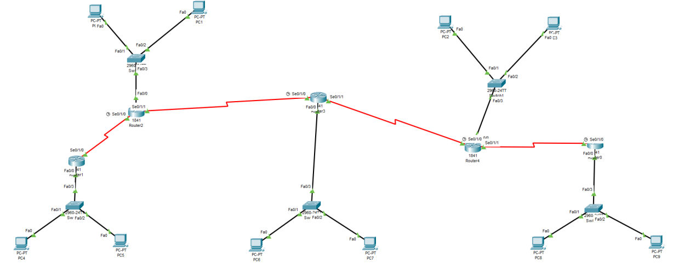
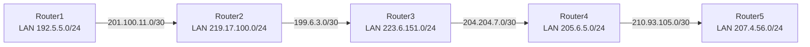
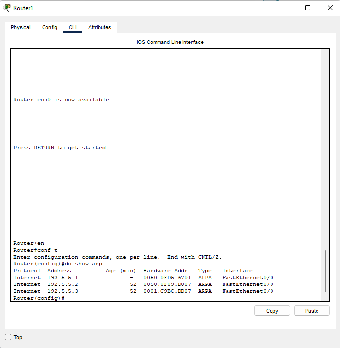
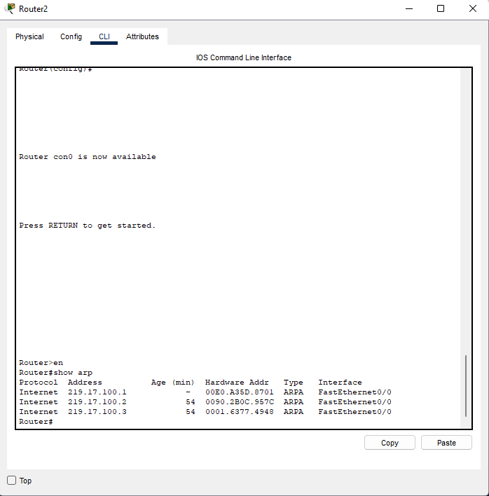
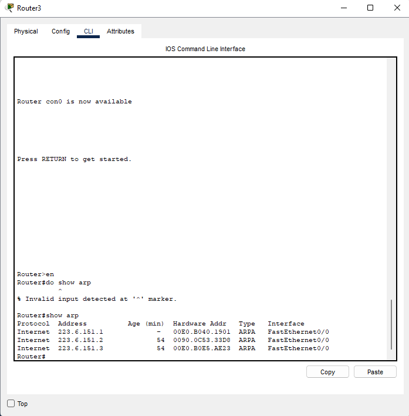
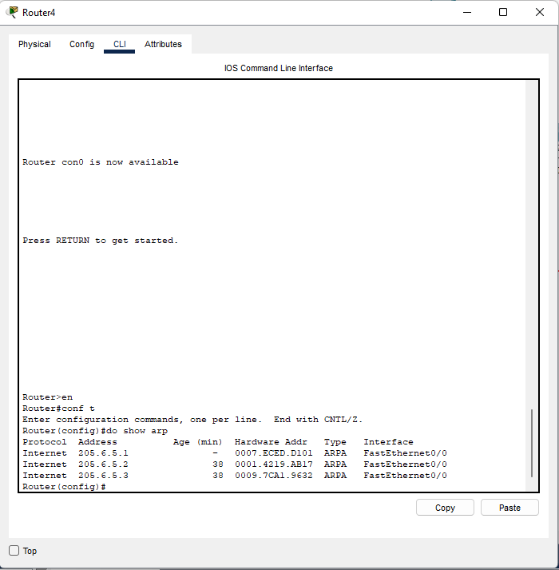
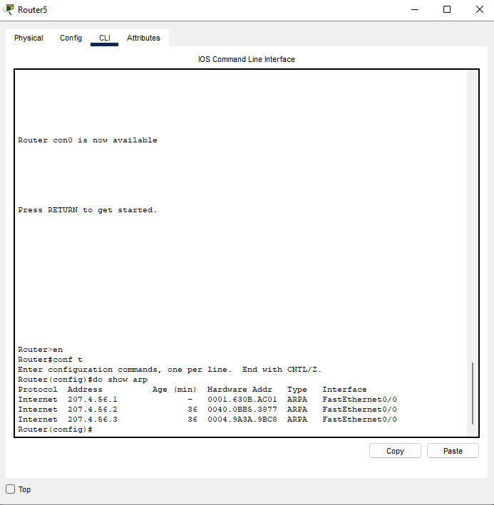
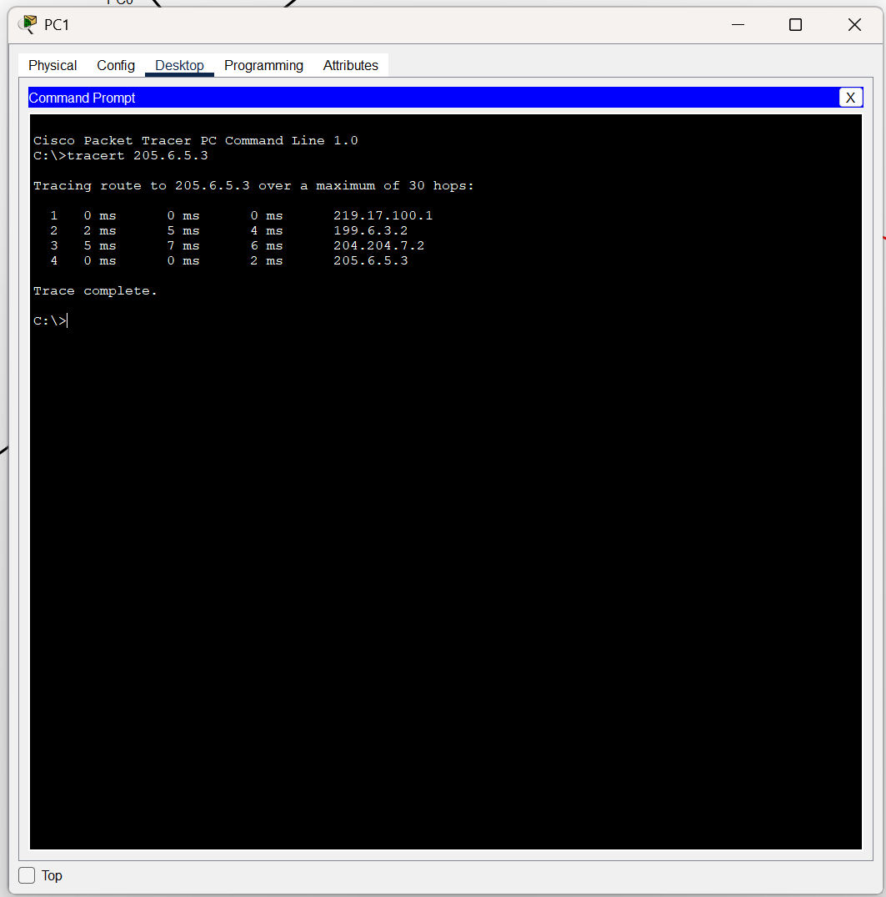
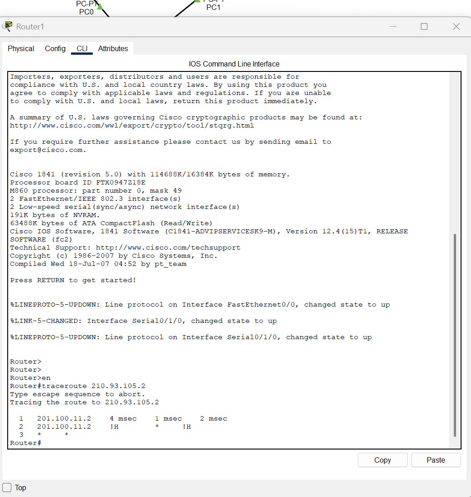
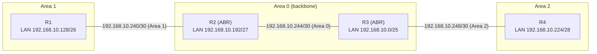

# TP Cisco – Routage statique & dynamique (OSPF) sur Packet Tracer

Travaux pratiques de réseaux réalisés sur **Cisco Packet Tracer** : mise en place d'une maquette de 5 routeurs en routage statique, puis d'une maquette de 4 routeurs en OSPF multi-zones avec un plan d'adressage VLSM, et enfin un court QCM de révision.

> Réalisé en groupe par Illyes, Alexandre et Mohammed.

## Sommaire

- [Contenu du TP](#contenu-du-tp)
- [Partie I – Routage statique](#partie-i--routage-statique)
- [Partie II – Routage dynamique OSPF](#partie-ii--routage-dynamique-ospf)
- [Partie III – QCM](#partie-iii--qcm)
- [Commandes utiles](#commandes-utiles)
- [Compétences mises en œuvre](#compétences-mises-en-œuvre)

## Contenu du TP

| Partie | Thème | Objectif principal |
|--------|-------|--------------------|
| I | Routage statique | Interconnecter 5 routeurs en chaîne avec des routes statiques |
| II | OSPF | Plan VLSM + configuration OSPF mono-zone puis multi-zones |
| III | QCM | Questions de cours (topologie, adressage, ARP, masques) |

## Partie I – Routage statique

### Objectifs

1. Créer la maquette sur Packet Tracer
2. Afficher les tables de tous les routeurs
3. Configurer les routeurs (routes statiques)
4. Afficher les sauts entre le routeur 1 et le routeur 5
5. Tracer la route entre PC1 et PC3
6. Enregistrer les configurations (`show running-config`)

### Topologie

Cinq routeurs Cisco 1841 reliés en chaîne par des liaisons série, chacun desservant un LAN (switch + 2 PC ou plus).


*Maquette réalisée sur Packet Tracer.*

Schéma logique :



### Plan d'adressage

| Équipement | Interface | Adresse IP | Masque |
|------------|-----------|------------|--------|
| Router1 | Fa0/0 (LAN) | 192.5.5.1 | 255.255.255.0 |
| Router1 | Se0/1/0 | 201.100.11.1 | 255.255.255.252 |
| Router2 | Fa0/0 (LAN) | 219.17.100.1 | 255.255.255.0 |
| Router2 | Se0/1/0 | 201.100.11.2 | 255.255.255.252 |
| Router2 | Se0/1/1 | 199.6.3.1 | 255.255.255.252 |
| Router3 | Fa0/0 (LAN) | 223.6.151.1 | 255.255.255.0 |
| Router3 | Se0/1/0 | 199.6.3.2 | 255.255.255.252 |
| Router3 | Se0/1/1 | 204.204.7.1 | 255.255.255.252 |
| Router4 | Fa0/0 (LAN) | 205.6.5.1 | 255.255.255.0 |
| Router4 | Se0/1/0 | 204.204.7.2 | 255.255.255.252 |
| Router4 | Se0/1/1 | 210.93.105.1 | 255.255.255.252 |
| Router5 | Fa0/0 (LAN) | 207.4.56.1 | 255.255.255.0 |
| Router5 | Se0/1/0 | 210.93.105.2 | 255.255.255.252 |

### Routes statiques configurées

Chaque routeur connaît les réseaux distants via le routeur voisin (next-hop) et dispose d'une route par défaut.

| Routeur | Routes statiques |
|---------|------------------|
| Router1 | `0.0.0.0/0`, `219.17.100.0/24`, `223.6.151.0/24`, `205.6.5.0/24`, `207.4.56.0/24` → via `201.100.11.2` |
| Router2 | `223.6.151.0/24`, `205.6.5.0/24`, `207.4.56.0/24`, `0.0.0.0/0` → via `199.6.3.2` ; `192.5.5.0/24` → via `201.100.11.1` |
| Router3 | `219.17.100.0/24`, `192.5.5.0/24` → via `199.6.3.1` ; `205.6.5.0/24`, `207.4.56.0/24`, `0.0.0.0/0` → via `204.204.7.2` |
| Router4 | `223.6.151.0/24`, `192.5.5.0/24`, `219.17.100.0/24` → via `204.204.7.1` ; `207.4.56.0/24`, `0.0.0.0/0` → via `210.93.105.2` |
| Router5 | `205.6.5.0/24`, `223.6.151.0/24`, `219.17.100.0/24`, `192.5.5.0/24` → via `210.93.105.1` |

Exemple (Router1) :

```text
ip route 0.0.0.0 0.0.0.0 201.100.11.2
ip route 219.17.100.0 255.255.255.0 201.100.11.2
ip route 223.6.151.0 255.255.255.0 201.100.11.2
ip route 205.6.5.0 255.255.255.0 201.100.11.2
ip route 207.4.56.0 255.255.255.0 201.100.11.2
```

### Captures des routeurs

Table ARP relevée sur chaque routeur (`show arp`) :

| Router1 | Router2 |
|:-------:|:-------:|
|  |  |

| Router3 | Router4 |
|:-------:|:-------:|
|  |  |

| Router5 |
|:-------:|
|  |

### Tests de connectivité

Traceroute depuis PC1 (réseau 219.17.100.0/24) vers un hôte du réseau 205.6.5.0/24 :

```text
C:\>tracert 205.6.5.3

  1   0 ms   0 ms   0 ms   219.17.100.1   (Router2)
  2   2 ms   5 ms   4 ms   199.6.3.2      (Router3)
  3   5 ms   7 ms   6 ms   204.204.7.2    (Router4)
  4   0 ms   0 ms   2 ms   205.6.5.3
Trace complete.
```


*Traceroute depuis PC1.*

Un `traceroute` depuis Router1 vers `210.93.105.2` (Router5) a aussi été réalisé pour observer les sauts entre les routeurs :


*Traceroute depuis Router1 : le trajet n'aboutit pas complètement (saut 2 en `!H`), des routes sont à compléter.*

## Partie II – Routage dynamique OSPF

### Objectifs

1. Établir un plan d'adressage VLSM pour les liens série et les sites
2. Configurer OSPF en une seule zone
3. Configurer OSPF en plusieurs zones
4. Enregistrer les configurations

### Plan d'adressage VLSM (base `192.168.10.0/24`)

| Besoin | Réseau | Plage utilisable | Masque | CIDR | Broadcast |
|--------|--------|------------------|--------|------|-----------|
| 70 hôtes | 192.168.10.0 | .1 – .126 | 255.255.255.128 | /25 | 192.168.10.127 |
| 50 hôtes | 192.168.10.128 | .129 – .190 | 255.255.255.192 | /26 | 192.168.10.191 |
| 26 hôtes | 192.168.10.192 | .193 – .222 | 255.255.255.224 | /27 | 192.168.10.223 |
| 12 hôtes | 192.168.10.224 | .225 – .238 | 255.255.255.240 | /28 | 192.168.10.239 |
| Lien série | 192.168.10.240 | .241 – .242 | 255.255.255.252 | /30 | 192.168.10.243 |
| Lien série | 192.168.10.244 | .245 – .246 | 255.255.255.252 | /30 | 192.168.10.247 |
| Lien série | 192.168.10.248 | .249 – .250 | 255.255.255.252 | /30 | 192.168.10.251 |

Les réseaux sont triés du plus grand au plus petit pour limiter le gaspillage d'adresses (VLSM).

### Topologie OSPF multi-zones



- **Area 1** : R1 (LAN /26), lien R1–R2 et LAN de R2
- **Area 0 (backbone)** : lien R2–R3
- **Area 2** : LAN de R3, lien R3–R4 et LAN de R4
- R2 et R3 sont des **ABR** (Area Border Routers)

### Configuration OSPF (extrait R2)

```text
router ospf 1
 log-adjacency-changes
 network 192.168.10.240 0.0.0.3 area 1
 network 192.168.10.192 0.0.0.31 area 1
 network 192.168.10.244 0.0.0.3 area 0
```

Les wildcard masks utilisés : `0.0.0.3` (/30), `0.0.0.15` (/28), `0.0.0.31` (/27), `0.0.0.63` (/26), `0.0.0.127` (/25).

## Partie III – QCM

| # | Question | Réponse |
|---|----------|---------|
| 1 | Un switch est utilisé sur quel type de topologie ? | Étoile |
| 2 | L'adresse logique 190.24.12.8 fait partie de quel réseau ? | `190.24.0.0` (classe B, masque par défaut /16) |
| 3 | Une adresse MAC s'exprime en quelle unité ? | Hexadécimale (ex. `00:1A:2B:3C:4D:5E`) |
| 4 | À quoi sert le protocole ARP ? | À trouver l'adresse MAC d'une station dont on connaît l'adresse IP |
| 5 | Un masque 255.255.255.224 permet combien de machines ? | 30 (`/27` → 2⁵ − 2 = 30 adresses utilisables) |

## Commandes utiles

```text
enable
configure terminal
show ip route            # table de routage
show arp                 # table ARP
show running-config      # configuration courante
show ip ospf neighbor    # voisins OSPF
show ip protocols        # protocoles de routage actifs
traceroute <ip>          # depuis un routeur
tracert <ip>             # depuis un PC (Packet Tracer)
```

## Compétences mises en œuvre

- Conception et câblage d'une maquette réseau sous Packet Tracer
- Adressage IPv4, découpage VLSM, calcul de masques et wildcards
- Routage statique et routes par défaut
- OSPF multi-zones (backbone, ABR)
- Diagnostic réseau : `traceroute`, `show arp`, `show running-config`

## Structure suggérée du dépôt

```text
.
├── README.md
├── images/               # captures utilisées dans ce README
├── partie1-routage-statique/
│   ├── maquette.pkt
│   └── configs/          # running-config de chaque routeur
├── partie2-ospf/
│   ├── maquette.pkt
│   └── configs/
└── docs/
    └── TP_CISCO.pdf
```

## Auteurs

Illyes, Alexandre et Mohammed.
